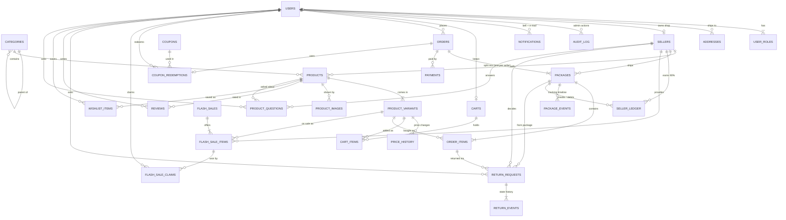

# TriVoKo database - ER diagram

30 tables, all created by Flyway (`backend/src/main/resources/db/migration`, V1-V14). GitHub draws the diagram
below from the text. Read a line like `ORDERS ||--|{ PACKAGES : "split into"` as: **one** order has **one or more**
packages. Every table belongs to exactly one module (see each module's `package-info.java`); another module never
reads it directly - it calls that module's service (checked by ArchUnit).

Tables without arrows: `processed_payment_events` (remembers each Stripe webhook id so a repeated webhook is
ignored - "idempotency"). Lucene's search index is not a table: it lives in a folder and is rebuilt from MySQL on start.

## Three ideas worth explaining in an interview

1. **One order, many packages.** `orders` is what the customer paid once; `packages` is what each seller ships.
   Returns, tracking and seller money all hang off the package, not the order.
2. **Money is a ledger, never a single number.** `seller_ledger` rows are added (sale +90%, refund -90%), never
   edited - like a bank passbook. A seller's balance is the SUM of their rows.
3. **History tables instead of overwriting.** `price_history`, `package_events`, `return_events`, `audit_log` keep
   every change with a time, so "lowest price in 30 days", the tracking timeline and "who approved this?" are just
   queries.
